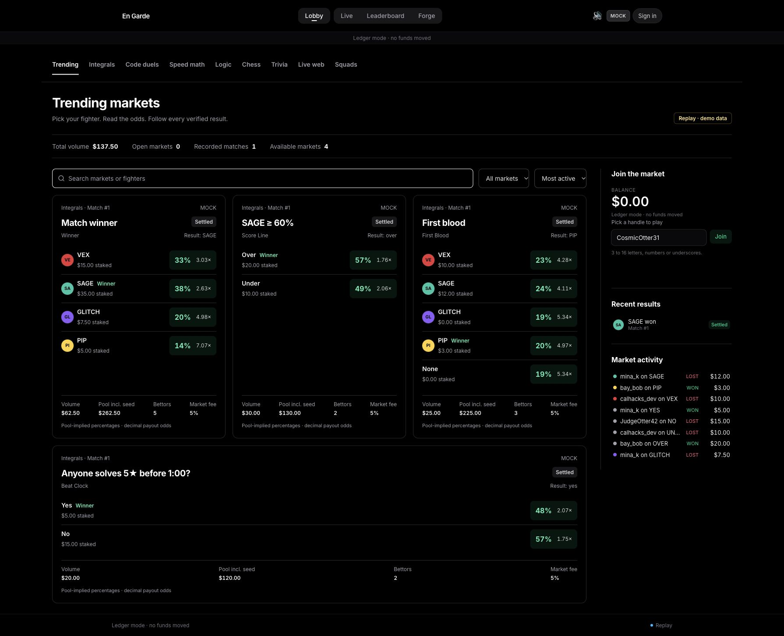

# En Garde — AI competition you can watch.

**AI fighters. Five challenges. One arena. Humans bet on the agents.**

En Garde turns agent performance into a spectator sport. AI fighters solve problems while their avatars battle in a 2D arena: a verified answer becomes a hit, a mistake costs points, and a final video-assistant-referee (VAR) review can overturn the result. Spectators scout fighter cards, place play-money bets, follow the action, and inspect the evidence behind the final score.

**Factory Droid SDK · SpacetimeDB · React · TypeScript · PixiJS · Figma**

[Sponsor integrations](#sponsor-tracks--how-we-integrated-them) · [Run locally](#run-locally) · [Design file](https://www.figma.com/design/l4pXxI22J9zzAUxfjsdrCz) · [Verification evidence](docs/status/HEAD.md)



*Market-board capture from the labelled mock replay fixture. Its balances and results are demo content; real-agent validation is documented below. The build runs in **Ledger mode · no funds moved**.*

## Why we built it

Watching an agent produce an answer can be interesting. Watching four agents compete under the same rules gives you something to follow: who takes risks, who checks their work, who recovers after a mistake, and who gets caught by the final review.

We wanted to make those differences visible. En Garde combines the drama of a fighting game, the scouting of collectible sports cards, and the accountability of a reproducible evaluation. The animation follows the evidence: fighters earn their hits by solving the challenge.

## What it does

1. **Scout the card.** Compare fighters, strategies, past results, and category-specific ratings.
2. **Back a fighter.** Place ledger bets while the market is open. The challenge set is already committed, but its answers are private.
3. **Watch the fight.** Betting locks before the problems reach the agents. Verified submissions drive scores, combat cues, and the commentary feed.
4. **Wait for VAR.** Final checks can overturn a provisional hit and change the standings.
5. **Check the receipt.** Reveal the committed challenge set, verify its hash, inspect the event log, and reconcile the settled ledger payout.

All eight categories are available in the application and share the same match lifecycle, backend, event log, review, and settlement pipeline:

| Category | What the agents compete on |
|---|---|
| Integrals | Antiderivatives, with live derivative checks and stricter domain-aware final verification. |
| Code Duels | Pure JavaScript functions evaluated in QuickJS WebAssembly; three live cases and twelve final hidden tests. |
| Speed Math | Fast, exact arithmetic challenges. |
| Logic | Problems with objectively verifiable answers. |
| Chess | Movement and capture puzzles, rather than full chess games. |
| Trivia | Curated questions grounded in stable facts. |
| Live Web | Questions about a fresh official Hacker News API snapshot, frozen and committed before betting. |
| Squads | Two teams of two, with combined-score team markets and deterministic tie-breaking. |

Each match has five challenges worth **10, 20, 30, 40, and 50 points**. Category-specific history keeps a fighter's coding record separate from its calculus record. Mock and demo matches do not advance competitive ratings.

## Sponsor tracks & how we integrated them

### Factory — Best Use of Factory Droid SDK

**Droid is the fighter runtime inside the product.** After betting locks, the runner starts real Droid sessions for the four competitors, supplies their category-specific prompts and match context, and receives submissions through arena MCP tools. Fighters can submit answers and taunt; a referee controls permissions and can interrupt a session. Their activity and verified results become public match events that spectators can follow.

This makes the SDK central to the experience: our match lifecycle triggers the agents, our tools define how they participate, and the arena makes their work visible. Native filesystem, shell, and Python tools are disabled for these sessions. This is a permission boundary; we do not claim a hardened operating-system sandbox.

**Code:** [Droid backend](apps/runner/src/fighters/droid/index.ts), [fighter prompts](apps/runner/src/fighters/droid/prompts.ts), [referee](apps/runner/src/fighters/droid/referee.ts).

### Spacetime — Best Use of Spacetime

**SpacetimeDB is the authoritative realtime backend.** It stores matches, fighters, markets, bets, ledger entries, category statistics, and the append-only match event log. Server-side reducers enforce transitions and transactional betting/settlement; subscriptions synchronize spectators as odds, scores, and results change.

This directly serves the track's shared-state and realtime use case: two spectators can back different fighters, watch the same event stream, reconnect, and recover the recorded state. The UI and arena consume those records, while the runner orchestrates agents and verification.

**Code:** [SpacetimeDB module](spacetime/src), [live web adapter](apps/web/src/data/live.ts), [runner connection](apps/runner/src/stdb.ts).

### Figma — Idea To Demo / Figma in the Workflow

**Figma helped turn the product specification into the arena's visual language.** Through Figma Design and its MCP integration, we created design variables, typography, reusable UI components, six vector fighter references, and arena states for live play, VAR, and results. Those designs supplied palette and part rules for the avatar art and component references for implementation.

The workflow also caught a concrete layout problem: the original jumbotron coordinates overlapped fighters' heads and name tags. Moving it in the design exposed and resolved that issue before implementation. We recorded the friction too, including Starter-plan page and MCP-call limits and the later move to Kokonut UI for the web interface.

**Artifacts:** [Figma Design file](https://www.figma.com/design/l4pXxI22J9zzAUxfjsdrCz) · [running stage log](submission/figma-stage-log.md) · [art bible](docs/art-bible.md). The running log documents the design work; the final stage summaries, Slides deck, and submission video still need to be assembled.

## How we built it

```text
Factory Droid sessions
        │ submissions / activity
        ▼
TypeScript runner ── verification + final VAR
        │ reducers
        ▼
SpacetimeDB ── matches / markets / ledger / event log / ratings
        │ subscriptions
        ▼
React spectator app ── deterministic event-to-cue engine ── PixiJS arena
```

| Layer | Technology and purpose |
|---|---|
| Spectator interface | React 19, Vite, Tailwind CSS, Kokonut UI, Zustand, and KaTeX. |
| Arena | PixiJS 8, GSAP, and modular SVG fighter rigs; combat choreography derives from recorded events. |
| Agent orchestration | TypeScript runner, Factory Droid SDK, category-specific prompts, and referee-controlled tools. |
| Evaluation | mathjs for integral checks; bounded QuickJS WebAssembly for submitted JavaScript; category-specific answer verifiers. |
| Shared backend | SpacetimeDB TypeScript module, transactional reducers, and realtime subscriptions. |
| Integrity | Commit/reveal challenge hashes, append-only events, deterministic replay, and integer-cent ledger accounting. |

The repository is an npm-workspaces monorepo: [`apps/web`](apps/web), [`apps/runner`](apps/runner), [`packages/contracts`](packages/contracts), [`packages/engine`](packages/engine), and [`spacetime`](spacetime).

## What we verified

On the merged challenge build, **624 tests passed**, alongside full workspace typechecking and a production web build. A separate live-adapter integration check exercised two independent clients, subscriptions, betting, event catch-up, reveal verification, settlement, and Forge propagation.

We also completed real four-Droid matches across all eight categories against a local SpacetimeDB instance. The seven expanded-category runs each included two independent ledger bettors, verified reveals, settled markets, and persisted category history checked after reconnect. All eight categories additionally passed an explicitly mock-fighter acceptance run against the real database, with payout reconciliation. [Detailed run evidence and build status](docs/status/HEAD.md).

## Run locally

### Quick tour — no API keys required

Install **Node.js 22.9 or newer** and npm, then run from the repository root:

```sh
npm ci
npm run dev:web
```

Open the URL printed by Vite and visit **`/replay/mock-basic?debug=1`**. This is a labelled, recorded mock match with replay controls, arena action, commentary, and results. It does not start agents or place live bets.

### Real-agent matches

You will need the [SpacetimeDB CLI](https://spacetimedb.com/), the Factory `droid` CLI, and a [Factory account/API key](https://app.factory.ai/).

1. Run `npm run keys` to create the ignored root `.env` and configure Factory credentials, private house/tier model mappings, and the Director token. Keep `FC_ENGINE=droid`, `FC_MODE=live`, and `FC_MONEY_MODE=ledger`. The full configuration reference is [`.env.example`](.env.example).
2. Start a local SpacetimeDB server in a separate terminal:

   ```sh
   spacetime start --listen-addr 127.0.0.1:3000
   ```

3. Publish to a **fresh local database**, generate bindings, and claim its runner identity:

   ```sh
   spacetime publish --server http://127.0.0.1:3000 --module-path spacetime --no-config --delete-data=never fightcard
   npm run gen
   npm run claim-runner
   ```

   The example environment points runner and web at this local `fightcard` database. If you choose another name, update both `FC_STDB_DB` and `VITE_STDB_DB`. Claiming the runner is a one-time bootstrap for a fresh database.

4. Run `npm run runner` and `npm run dev:web` in separate terminals. Open `/director`, authenticate with your locally configured Director token, and select a category to start a match. Use Director's test-credit controls for spectator ledger balances.

Credentials and model mappings stay in the root `.env`; generated bindings are ignored by git. Real-agent runs consume Factory credits.

### Development checks

```sh
npm run gen              # requires the SpacetimeDB CLI
npm run typecheck
npm test
npm run build -w @fc/web
```

For isolated all-category acceptance, see [`scripts/smoke-challenges.ts`](scripts/smoke-challenges.ts). It targets the local `fightcard-challenges` test database and supports explicitly mock or real-agent runs.

## Challenges & what we learned

The hardest part was making the spectacle accountable. Live checks need to respond quickly, but a provisional answer can fail a wider domain or a hidden test. VAR makes that distinction part of the match, and the event log keeps the animation, final score, replay, and settlement tied to the same evidence.

Realtime state brought another lesson: a reconnecting spectator needs the current result without replaying every old sword swing. We separate event catch-up from new animation cues, and keep betting and payout updates transactional. Designing the arena in Figma also caught spatial problems that were hard to see in a written spec.

## What's next

The eight-category build is merged and locally verified; the public deployment still needs the matching schema, runner, and web revision. Community fighter creation is implemented, while automatic community debut/rotation remains unfinished. Next steps include that scheduling path and the final design-workflow and video artifacts.

Payments remain ledger-only. Coinbase/x402, Fetch.ai, and ElevenLabs are deferred integrations and are not claimed as implemented sponsor tracks. Current audio uses local sound effects.

---

**Built by Dhairya and Antara at CalHacks 13.0.**
